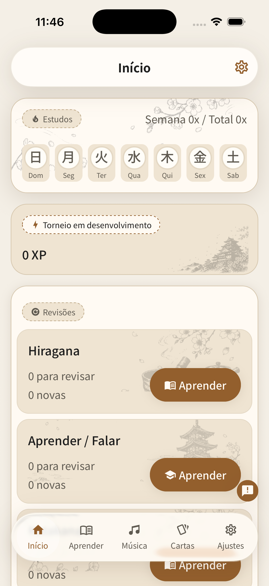
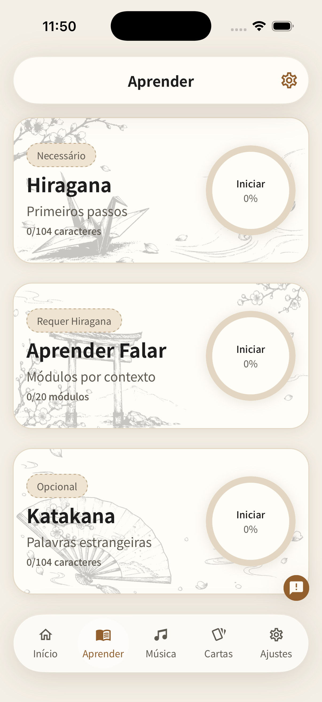
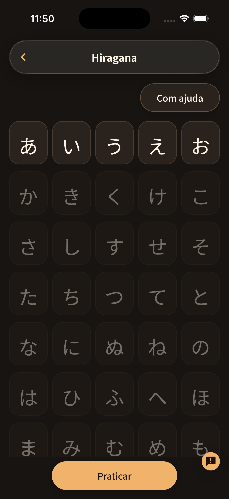
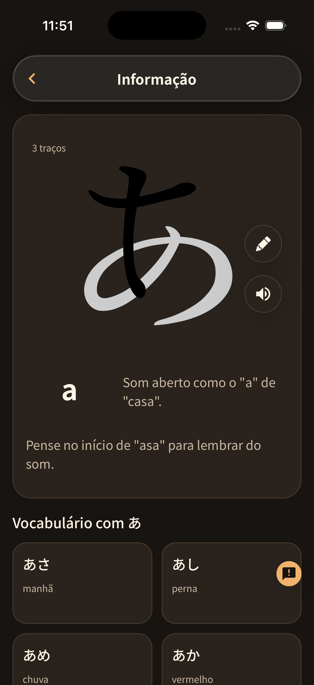
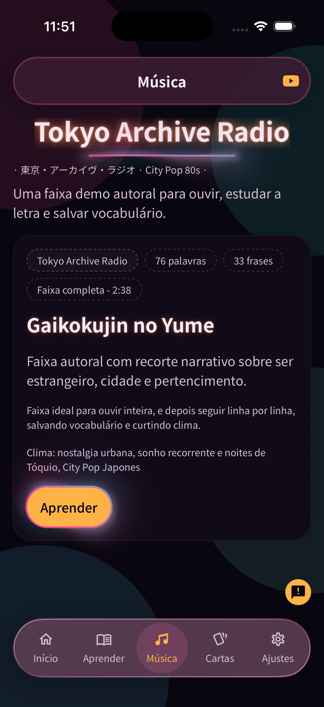
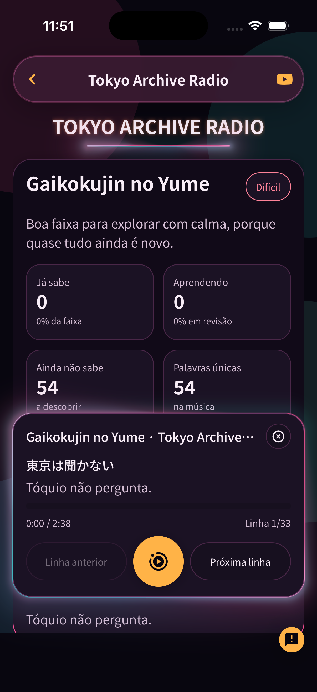
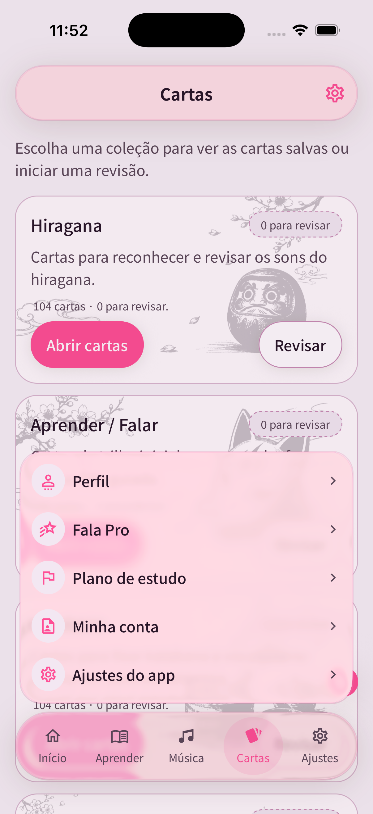
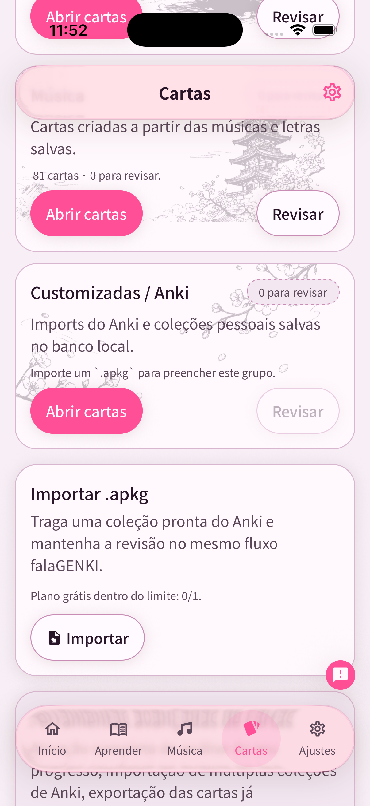

# Modo Nihongo: Japonês

**A published iPhone app for Brazilian Portuguese speakers learning Japanese.**

Formerly known as falaGENKI, Modo Nihongo is an independently developed React Native and Expo application designed to make everyday Japanese study approachable through guided lessons, practice and spaced repetition.

[Download on the App Store](https://apps.apple.com/jp/app/modo-nihongo-japon%C3%AAs/id6812194613) · [Brazilian App Store](https://apps.apple.com/br/app/modo-nihongo-japon%C3%AAs/id6812194613)

**Status:** Released on the App Store for iPhone. The initial learning experience is currently free. Development and updates continue.

## Product

- **Learn:** guided Japanese lessons with explanations in Brazilian Portuguese.
- **Kana:** hiragana and katakana maps, character practice and audio examples.
- **Practice:** vocabulary, listening, reading and sentence-building activities.
- **Review:** a custom spaced-repetition system for regular study.
- **Progress:** personalized study plan, reminders and progress saved on the device.
- **Offline access:** study locally available content without requiring a network connection or account.
- **Optional sign-in:** Sign in with Apple for study-plan settings backup.

The live App Store listing is the reference for current features and screenshots.

## Engineering

| Product requirement | Engineering approach |
| --- | --- |
| Guided lessons and review | Typed domain models, feature modules and a dedicated SRS scheduler |
| Study without an account | Local SQLite persistence with Drizzle ORM |
| Structured learning content | Schema validation, reference checks and reusable content models |
| Audio practice | Asset manifests, playback and local caching infrastructure |
| Optional account services | Supabase integration and a separate account boundary |
| Maintainable UI | Expo Router, reusable React Native components and semantic theme tokens |
| Release and iteration | Automated validation, testing, device QA and App Store delivery |

## Tech Stack

| Layer | Tools |
| --- | --- |
| Mobile runtime | React Native, Expo |
| Language & navigation | TypeScript, Expo Router |
| Local data | SQLite, Drizzle ORM |
| Backend integration | Supabase |
| Audio | Expo audio and asset tooling |
| Content validation | Zod |
| Quality | Jest, React Native Testing Library, ESLint |

The product source code is private. This repository is a public engineering showcase, not an installable source repository.

## Development History

The project started under the name **falaGENKI** before becoming Modo Nihongo: Japonês. Earlier experiments included music-assisted vocabulary study; the Japanese-learning app is now focused on its core study experience.

The following screens are historical captures from May 17, 2026. They illustrate the earlier product and development process; they do not represent the current App Store interface. Music-related screens show an earlier experimental direction and are not presented as features of the current released app.

<table>
  <tr>
    <td align="center" width="25%"><strong>Home</strong> Daily rhythm, study week, XP, and review shortcuts. </td>
    <td align="center" width="25%"><strong>Learn</strong> Guided paths for hiragana, speaking modules, and katakana. </td>
    <td align="center" width="25%"><strong>Hiragana Map</strong> Character grid with assist mode and practice entry point. </td>
    <td align="center" width="25%"><strong>Kana Detail</strong> Stroke count, sound, mnemonic, and vocabulary examples. </td>
  </tr>
  <tr>
    <td align="center" width="25%"><strong>Music Library</strong> Original City Pop demo track prepared for lyric study. </td>
    <td align="center" width="25%"><strong>Lyric Player</strong> Line-by-line listening with Japanese lyrics and PT-BR meaning. </td>
    <td align="center" width="25%"><strong>Cards + Menu</strong> Deck catalogue, review actions, and settings surfaces. </td>
    <td align="center" width="25%"><strong>Anki Import</strong> APKG import path for bringing existing decks into the app. </td>
  </tr>
</table>

## Delivery

I designed and implemented the application independently, including the learning flows, data model, review logic, audio workflow, UI and release process. Publishing the app was a milestone in an ongoing product development cycle, with updates driven by testing and improvements to real learner workflows.

[Developer profile](https://github.com/tarcisiowes)
